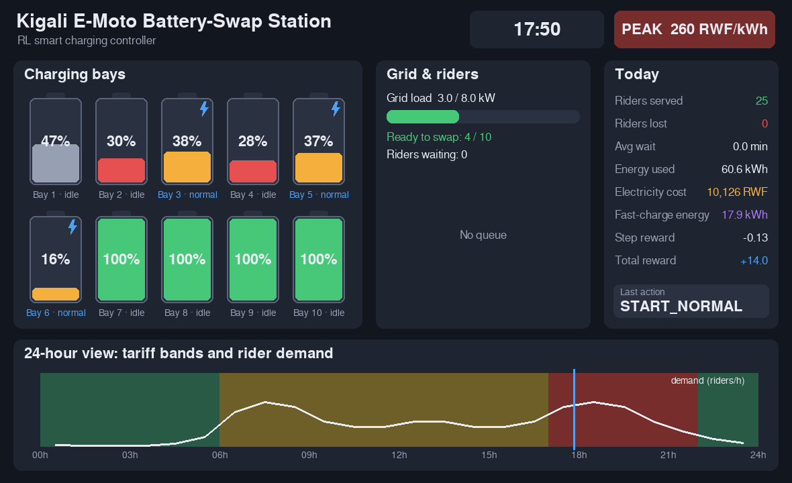

# Delucie Rurangwa – RL Summative: Smart Charging for an E-Moto Battery-Swap Station

**Mission:** reduce waiting time at electric moto-taxi battery-swap stations in Kigali while keeping electricity cost and battery wear low.

The agent is the station's smart charging controller. Every 10 simulated minutes it decides how the chargers run. Riders arrive at random (busier during the morning and evening rush), take a fully charged battery and leave their depleted one. If no battery is ready, they wait; after 30 minutes they leave.



## Environment summary

| Item | Design |
|---|---|
| Episode | One day, 00:00–24:00, 144 steps of 10 minutes |
| Actions (Discrete 6) | `HOLD`, `START_NORMAL`, `START_FAST`, `BOOST`, `SLOW_DOWN`, `PAUSE` |
| Observation (Box 27, float32) | charge level of 10 batteries, 10 charger modes, queue length, time of day (sin/cos), tariff band, demand forecast, grid load, batteries ready |
| Reward | +1 per rider served, −0.1 per rider waiting per step, −2 per rider lost, −electricity cost (1 point = 1000 RWF), −0.05 per fast-charged kWh, −0.05 per invalid action |
| Start | 00:00, batteries at random charge levels (options: `init_soc="low"/"full"`, `demand_scale`) |
| Terminal | End of day (truncation) or 15 riders lost (station failure, −10) |
| Constraints | 8 kW grid connection; normal charging 1 kW, fast charging 2.5 kW; time-of-use tariff |

All parameters are simulation assumptions documented in `environment/custom_env.py`.

## Run it

Requires [uv](https://docs.astral.sh/uv/).

```bash
uv sync
uv run main.py                 # watch the simulation (random agent for now)
uv run main.py --no-render     # terminal output only
uv run pytest                  # environment tests
```

## Project structure

```
environment/   custom_env.py (Gymnasium env), rendering.py (pygame visualisation)
training/      dqn_training.py, pg_training.py (TorchRL)
models/        saved models (dqn/, pg/)
logs/          training logs and hyperparameter results
assets/        screenshots and plots
tests/         environment tests
```
